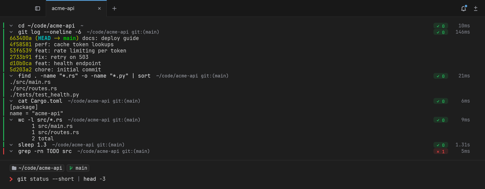

<p align="center">
  
</p>

<h1 align="center">Rift</h1>

<p align="center">
  A fast, block-based terminal for macOS and Linux.<br>
  <a href="https://github.com/botjaeger/rift-releases/releases/latest"><b>Download the latest release</b></a>
</p>



## What is it

Rift is a terminal emulator. It runs your usual shell (zsh, bash or fish) and
every program you already use: vim, tmux, htop, ssh, coding agents. What
changes is how the output is organised: each command you run becomes a
**block** that holds the command, its output, its exit status and how long it
took.

## What it does

- **Command blocks.** Select a block with ⌘↑, copy just its output, collapse
  it, filter its lines, bookmark it, re-run it, or send its output to another
  command. Failed commands stand out in red.
- **A real editor for the command line.** Syntax highlighting, completions
  with descriptions, ghost suggestions from your history, multi-line editing,
  undo, and optional vim keys, all before the shell sees anything.
- **Tabs and split panes.** Horizontal or vertical tabs, draggable splits,
  synchronized input across panes, and a switcher (⇧⌘O) for every tab, pane
  and recent block.
- **Command palette.** ⌘P finds every action, setting, theme and history
  entry. Every shortcut can be rebound.
- **Built in tools.** A file explorer with git status (⇧⌘E), a code review
  panel to stage or revert files and hunks (⇧⌘G), hint mode for links and
  paths (⇧⌘H), and inline images (kitty graphics and iTerm2).
- **Notifications.** Finished and failed commands, password prompts and
  coding agents (Claude Code, Codex, OpenCode, Gemini CLI) land in one inbox,
  with a toast when the tab is out of view.
- **Your sessions survive.** Tabs, splits and directories come back on launch,
  and the shells themselves keep running when Rift quits or updates.
- **Phone companion.** Pair an iPhone or Android phone by QR code to follow
  your panes live, run commands and answer prompts from anywhere.
- **Warp's habits.** Warp's default shortcuts, and its themes and launch
  configurations work unchanged.

## Why

A classic terminal is one long scroll: finding the output of the build that
failed ten minutes ago means scrolling and selecting by hand. Rift knows where
every command starts and ends, so that is one keystroke.

Rift was also built so that **an update never costs you your work**. Updating
some terminals closes every tab and kills every running shell. Rift installs
an update and restarts around your shells: the tabs, splits and the programs
running in them are still there afterwards.

## Why not

Rift may not be for you if:

- **You are on Windows.** Rift runs on macOS 11+ (Apple silicon and Intel)
  and Linux x86_64 only.
- **You want AI in your terminal.** Rift has no built-in AI, no account and no
  cloud. Coding agents run in it like any other program.
- **You live in another shell.** Blocks need zsh, bash or fish. Other shells
  (nu, xonsh, …) still work, as a plain terminal.
- **You need a notarized app.** The macOS app is ad-hoc signed: the first
  launch needs *right-click → Open* once.
- **You want the phone app from a store.** It is not in the App Store or Play
  Store yet.
- **You want a mature tool.** Rift is new (0.x). Expect rough edges and
  report them.

## Safety and privacy

- **No account, no telemetry, no analytics.** Rift sends nothing about you or
  your commands anywhere.
- **Its only connection on its own is the update check**: it downloads a
  small file, `latest.json`, from this repository at launch and every 6 hours.
  Turn it off with `check_for_updates = false` in `~/.config/rift/config.toml`.
- **Updates are signed.** Rift refuses a release unless `latest.json` carries
  a valid Ed25519 signature from the maintainer's offline key, and every
  download must match the SHA-256 that file lists. Someone who could write to
  this repository still could not ship you code.
- **The phone companion is off until you turn it on.** Phones are paired by QR
  code and pinned to your computer's key; the connection is end-to-end
  encrypted (the Noise protocol). A relay, if you use one, forwards only
  ciphertext and holds no key. Each phone can be limited to view-only, and
  revoked at any time.
- **Untrusted output stays untrusted.** Escape sequences, inline images and
  links in program output are size-limited and checked; a link to a file that
  would run as a program (an app, a `.webloc`, a configuration profile) is
  shown in Finder instead of opened, and a multi-line paste into a program
  that does not expect one asks first.
- Everything Rift keeps stays on your machine: settings in `~/.config/rift/`,
  sessions and saved output in `~/.local/share/rift/`.

## Performance

Rift renders on the GPU (wgpu) and ships as a single binary with its fonts,
themes and shell hooks embedded. Measured on an Apple M-series Mac with a
release build:

| Scenario | Result | Peak memory |
|---|---|---|
| Launch to first prompt | 322 ms | 107 MiB |
| `seq 1 500000` (500,000 lines) | 544 ms | 138 MiB |
| `cat` a 20 MiB file | 286 ms | |
| 300,000 lines into a 100,000-line scrollback | | 169 MiB |
| Key press to frame on screen | 4.3 ms median, 8.4 ms p95 | |

Scrollback is stored compactly, so long histories cost little memory, and wide
characters and emoji are measured the way your shell measures them, so
prompts and TUIs line up.

## Install

Download from the [latest release](https://github.com/botjaeger/rift-releases/releases/latest):

| System | File |
|---|---|
| macOS, Apple silicon | `Rift-<version>-arm64.dmg` |
| macOS, Intel | `Rift-<version>-x86_64.dmg` |
| Debian / Ubuntu | `rift-terminal_<version>_amd64.deb` |
| Any Linux | `Rift-<version>-x86_64.AppImage` |
| Binary only | `rift-terminal-<version>-<os>-<arch>.tar.gz` |

**macOS**: open the DMG, drag Rift to Applications, then right-click → Open
the first time.

**Debian / Ubuntu**:

```sh
sudo dpkg -i rift-terminal_<version>_amd64.deb
sudo apt-get install -f   # only if dpkg reports missing dependencies
```

**AppImage**:

```sh
chmod +x Rift-<version>-x86_64.AppImage
./Rift-<version>-x86_64.AppImage
```

On Ubuntu 24.04 an AppImage needs `sudo apt install libfuse2t64` first.

After that, the Mac app and the AppImage update themselves: *Update Rift*
appears in the tab bar when a release is out. Each release's notes are also
in the app under Help → What's New.

## Getting started

1. Open Rift. Your login shell starts with Rift's integration loaded; nothing
   to add to your rc files.
2. Type a command and press ⏎. It becomes a block.
3. Press ⌘↑ to select it, ⌥⇧⌘C to copy its output, ⌘P to see every action.
4. ⌘, opens Settings. Everything is saved to `~/.config/rift/config.toml`,
   which you can also edit by hand.

On Linux, ⌘ is the Super key, and most actions also have a ⌃⇧ chord.

---

This repository holds Rift's release downloads and the update manifest the
app reads. Rift's source is developed in a separate repository.
